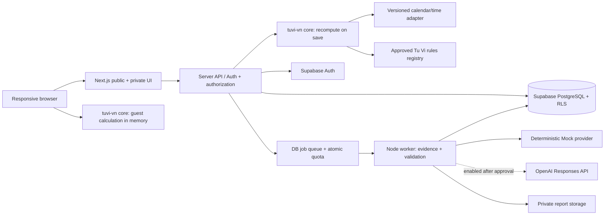

# TUVI STUDIO — Kiến trúc Website

**Đề xuất chờ phê duyệt**, 21/10/2026. Nền tảng **Web-only đã chốt**; MVP chỉ có **Tử Vi Đẩu Số Việt Nam**. Không có ứng dụng native hoặc tài khoản dịch vụ nào được tạo. Prototype HTML ở `docs/design/prototype/` là artifact đánh giá, không phải codebase sản phẩm Next.js.

## 1. Quyết định kiến trúc đề xuất

Một Next.js application cho public site, không gian người dùng và admin; backend-for-frontend cùng repo, worker riêng chỉ cho job dài. Supabase quản lý PostgreSQL/Auth/private storage. Lõi chart TypeScript thuần, deterministic, không phụ thuộc React, database hoặc mô hình AI. Đây là **modular monolith**, chưa có lý do để chia microservice hoặc xây framework plugin tổng quát.

| Thành phần | Đánh giá và lựa chọn đề xuất | Giới hạn cần kiểm tra ở M1/M2 |
| --- | --- | --- |
| Next.js + React + TypeScript | SSR/SSG public SEO, route handlers server, client components cho chart/chat. [Tài liệu deployment](https://nextjs.org/docs/app/getting-started/deploying) hỗ trợ Node/Docker; không buộc Vercel | Auth, cache và job timeout phải kiểm tra ở host được chọn; pin phiên bản tương thích khi được phép scaffold |
| Tailwind CSS | Token semantic và responsive utilities; [theme variables](https://tailwindcss.com/docs/theme) hỗ trợ map palette | Không đưa 3 concept cùng lúc vào sản phẩm nếu chỉ duyệt một hướng |
| shadcn/ui chọn lọc | Button, form, dialog, table primitives, code sở hữu trong repo theo [tài liệu](https://ui.shadcn.com/docs); chart 12 cung làm component riêng | Không mặc định toàn bộ component đạt accessibility; review focus/keyboard và license từng thành phần trước nhập |
| Supabase PostgreSQL/Auth/RLS | JWT identity, quan hệ dữ liệu, owner policies, private storage | [RLS](https://supabase.com/docs/guides/database/postgres/row-level-security) phải bật cho bảng exposed. Service-role chỉ server/worker, không thay test authorization |
| Server AI provider | Một interface nội bộ `interpret(request)`, **Mock mặc định**, OpenAI adapter khi được duyệt | Không có key thì chạy Mock, không trả lỗi bí mật hoặc giả kết quả Real. Real được cấu hình rõ; không fallback Mock âm thầm |
| Vitest / Playwright | Unit/contract/integration và E2E Chromium/Firefox/WebKit theo [Vitest](https://vitest.dev/guide/), [Playwright](https://playwright.dev/docs/intro) | Chưa cài vào app vì chưa có app được duyệt; Chrome prototype checks không phải suite của app |
| GitHub Actions | CI gates và preview/staging/deploy được phê duyệt | Secrets tối thiểu, action pin SHA và không cấp secret cho PR không tin cậy theo [GitHub](https://docs.github.com/en/actions/reference/security/secure-use) |
| PWA | Future, chỉ nghiên cứu | Service worker/cache chart riêng tư làm tăng rủi ro; không đưa offline/install prompt vào MVP |

**Đã loại khỏi kế hoạch đang hiệu lực:** Expo, React Native, EAS Build, Maestro, native signing, App Store/Google Play submission và phí store. Các nguồn đã đọc trước quyết định Web-only chỉ là lịch sử nghiên cứu, không tạo dependency hoặc task triển khai.

## 2. Sơ đồ hệ thống



Khách có thể xem chart tính trong memory trình duyệt khi engine/profile đã approved; chưa lưu sinh trên server. Khi đăng nhập/lưu, server tính lại từ input đã xác nhận, không tin JSON chart gửi từ client. Profile/rule/calendar data phải giống nhau hai nơi. Không dùng `Intl`/timezone của OS làm oracle lịch sử không có version; adapter calendar/time có dependency và dữ liệu được ghim, hợp đồng test parity.

Nếu bundle/timezone data quá nặng hoặc không bảo đảm parity, phương án thay thế là server-only calculation với consent và rate-limit; quyết định ở spike M2, không duy trì hai thuật toán khác nhau.

## 3. Cấu trúc repository đề xuất

Chỉ là sơ đồ, chưa tạo các package/app bên dưới. Một workspace có một website; packages chỉ tạo khi có code cần chia sẻ giữa browser/server/test.

```text
apps/
  web/
    src/app/
      (public)/             # /, /kien-thuc, /premium: indexable khi nội dung hợp lệ
      (account)/            # /ho-so, /la-so/[id], /chat/[id]: private, no-store
      admin/                # private role checks trên server
      api/v1/               # authenticated mutation, jobs, billing webhooks
    src/components/         # UI primitives và chart view
    src/features/tuvi/      # feature UI Tử Vi, không tạo tính năng hệ khác
    src/server/             # auth, repositories, billing, AI provider adapters
    tests/e2e/
workers/
  interpretation/           # chỉ tách khi job vượt giới hạn request host
packages/
  contracts/                # transport envelope + riêng namespace tuvi-vn
  tuvi-core/                # deterministic engine, tables/rules đã approved
  calendar/                 # calendar/time primitives khi đã có nhu cầu thật
  design-tokens/            # chỉ nếu worker/app cần artifact dùng chung; nếu không giữ trong web
supabase/
  migrations/               # SQL, indexes, RLS, RPC/transactions
  tests/                    # authorization, tenant boundary, quota ledger
docs/                       # tài liệu và prototype hiện có tiếp tục được giữ
.github/workflows/          # CI/deploy sau phê duyệt
```

Không tạo thư mục rỗng cho western/feng-shui hoặc một plugin runtime. Có thể gộp `contracts/calendar` vào `tuvi-core` ban đầu nếu chưa có consumer độc lập. Dùng npm workspaces ban đầu để tận dụng môi trường; pnpm có thể xét sau, không cần cài chỉ để khởi động kế hoạch.

## 4. Ranh giới nhiều hệ thống trong tương lai

| Hệ | Namespace dự kiến | Riêng biệt | Có thể chia sẻ |
| --- | --- | --- | --- |
| Tử Vi Việt Nam, MVP | `tuvi-vn` | input/profile, palace roles, star rules, chart schema, prompt/retrieval corpus | account, quota/billing, UI primitives, observability |
| Chiêm tinh phương Tây, Future | `western-astrology` | tropical/sidereal, ephemeris, zodiac signs, houses/aspects, rules và AI corpus riêng | vỏ UI, identity; calendar primitive chỉ nếu cùng quy ước |
| Lịch âm/Can Chi, Future | `calendar-vn` | lịch và Can Chi theo profile; không tự có luận chart | dữ liệu calendar đã licensed/tested nếu thực sự tương thích |
| Nội dung/phép luận phong thủy, Future | Namespace riêng theo phương pháp được duyệt | thuật toán, bảng, nội dung và AI policy của phương pháp | account và hạ tầng; không dùng Tử Vi stars để trả lời |

Transport chung có `systemId`, `artifactType`, `schemaVersion`, `rulesetVersion`, `artifactId`. Payload **không** là một `GenericChart` với tất cả trường optional. Runtime MVP có allowlist duy nhất `tuvi-vn`; schema ở [chart.schema.json](chart.schema.json) dùng `systemId: const tuvi-vn`. Mỗi artifact được đọc bằng schema của chính hệ đó. Tương lai thêm schema khác, không đổi ý nghĩa trường cũ.

`palace.roleId` (Mệnh/Quan Lộc…) khác `palace.branchId` (Tý…Hợi), khác Western `signId`; `birthYearBranch` cũng không là cung hoàng đạo. Prompt/knowledge retrieval key bắt buộc `(systemId, rulesetVersion, locale)`. Không tìm thấy corpus tương ứng thì `UNSUPPORTED_SYSTEM`/`RULESET_UNAVAILABLE`, không fallback corpus Tử Vi.

Shared billing định nghĩa capability như `tuvi-vn.ai-turn` thay vì mặc định “Plus có AI mọi hệ”. Tương lai chỉ thêm capability được kinh doanh duyệt. Không dùng chat chung xuyên hệ trong MVP; một session gắn một system + artifact revision. Những ranh giới này là thiết kế dữ liệu tối thiểu, chưa triển khai module ngoài MVP.

## 5. Dependency rules

`UI → contracts → tuvi-core → calendar/rules`; `server → contracts/core/repositories/provider`. Core không import UI, DB, secret hay OpenAI SDK. Calendar không import phép luận. AI worker dùng **fact projection do core/server tạo**, không nhận quyền chạy tính sao hoặc truy vấn mọi chart. `MockProvider` và `OpenAIProvider` cùng output contract; Mock là fixture có nhãn, không mô phỏng một oracle thật.

## 6. Database schema đề xuất

Không tạo migration production trong Phase 02. UUID keys, timestamptz cho sự kiện; ngày sinh lưu date/local time có semantic riêng. Dữ liệu sinh gốc và chart được xem là riêng tư; chart có thể suy ngược thông tin nên cũng phải bảo vệ.

| Bảng | Trường/cấu trúc chính | Quyền và ràng buộc |
| --- | --- | --- |
| `profiles` | id FK auth.users, display_name, locale, created_at | Owner read/update allowlisted fields; role không do client ghi |
| `birth_records` | id, owner_id, raw_input JSONB có schema, normalized_input, consent_version, revision, deleted_at | Owner policy; dữ liệu sinh chỉ nạp khi cần edit/recompute, không join vào log/AI projection |
| `chart_artifacts` | id, owner_id, birth_record_id, system_id, revision, schema_version, engine/rules/calendar versions, chart JSONB, hash | Immutable; unique(owner_id,birth_record_id,revision,system_id); composite FK bảo đảm cùng owner |
| `cycle_artifacts` | id, owner_id, chart_id, year, ruleset_version, status, payload/hash | Immutable theo chart revision; scope tách base chart |
| `analysis_sessions` | id, owner_id, system_id, chart_id, mode, created_at | FK cùng owner/system; không tự đổi chart của session cũ |
| `analysis_messages` | id, session_id, owner_id, role, sanitized text, structured_result, provider_mode, model/prompt versions | Owner; dữ liệu private, retention theo consent; không storage public |
| `analysis_jobs` | id, owner_id, session_id, idempotency_key, state, attempts, lease_until, budget_reserved, result_ref | unique(owner_id,idempotency_key); API/worker transitions có transaction, không user direct update |
| `plans`, `prices`, `capabilities` | ID/version, VND integer amount, duration, feature limits | Published read; admin write có audit; historical price immutable |
| `orders`, `payment_events` | owner_id, provider/order/event IDs, price_version, amount/currency/status | unique(provider,event_id), unique(provider,order_id); server xác minh chữ ký/số tiền/currency |
| `entitlements` | owner_id, capability, source_order_id, start/end, status | Chỉ server cấp sau verified payment; client read own |
| `usage_ledger` | owner_id, capability, period, reservation_id, delta, job_id | Append-only, unique event; atomic reservation/finalize/release; không `count()` rồi insert ngoài transaction |
| `knowledge_rules` | system_id, ruleset/version, source/license, approved_by, content_hash, publication_state | Worker chỉ đọc approved; nội dung private drafts không được public/retrieve |
| `audit_events` | actor/role/action/target/request_id/time, sanitized metadata | Server append; admin theo role; không raw birth/chat hoặc secret |
| `deletion_requests` | owner_id, state, deadlines, affected storage/job scopes | Khóa access nhanh; job không tái tạo nội dung của account đang xóa |

**RLS:** bảng private bắt đầu deny-all rồi policy owner `auth.uid()=owner_id` cho phép thao tác hợp lệ; update dùng cả USING/WITH CHECK. Server API cũng kiểm user, role, chart, system và capability. Service-role bypass RLS nên worker phải dùng narrow transaction/RPC, scope job và kiểm ownership, không expose service key. Storage bucket private có policy theo owner; signed URL TTL đề xuất 5 phút. Audit không chứa URL signed token. [Supabase RLS](https://supabase.com/docs/guides/database/postgres/row-level-security) là cơ chế hỗ trợ, không tự bảo đảm mọi policy đúng.

Index: owner+updated/revision, session+created, job(state,lease_until), payment unique IDs, rule(system_id,version,state). Chỉ xem xét partitioning/vector search khi có số đo. Corpus đầu tiên nhỏ có thể retrieve theo rule IDs đã xác định, không cần vector DB mới.

## 7. API contracts đề xuất

HTTP JSON, version `/api/v1`, TLS. Mutations có `Idempotency-Key` khi có thể lặp và `If-Match` cho mutable revision. Error envelope: `{error:{code,message,fieldErrors,requestId}}`; không stack trace hoặc raw payload. 400 invalid, 401 unauthenticated, 403 forbidden, 404 cho artifact không sở hữu để tránh enumeration, 409 version/quota conflict, 422 unsupported birth/profile/system, 429 rate limit, 503 provider/job unavailable. Hành vi quota chi tiết trả code machine-readable.

| Route | Request | Response / hành vi |
| --- | --- | --- |
| `POST /charts` | `{systemId:'tuvi-vn',birthInput,approvedRulesetVersion,acceptedNormalizationHash}` | Auth; tính lại server; 201 `{id,revision,chart,etag}`. Hash khác normalization preview →409, không lưu ngầm |
| `GET /charts?cursor=…` | Auth cursor, limit≤50 | Danh sách metadata owner, không raw birth hoặc toàn chart |
| `GET /charts/:id` | Auth | 200 artifact đúng owner; no-store; không quyền →404 |
| `PATCH /birth-records/:id` | Input mới + If-Match | Server normalizes/recomputes và tạo chart revision mới; 409 nếu stale; báo cáo cũ giữ chart cũ |
| `DELETE /charts/:id` | Auth + confirmation intent từ UI | 202 deletion state; chặn job mới; purge theo policy, không xóa ledger giao dịch bắt buộc giữ theo chính sách đã duyệt |
| `POST /charts/:id/cycles` | `{year,profileVersion}` | Tính overlay deterministic cho chart revision; status explicit |
| `POST /analysis-sessions` | `{systemId,chartId,chartRevision,consentVersion}` | 201 session; không nhận chart JSON tùy ý; system không hỗ trợ →422 |
| `POST /analysis-sessions/:id/messages` | `{text,maxLength:…}`; server áp length≤2000 chars | 202 `{jobId,state,providerMode,quotaRemaining}` sau reserve; cùng key cùng body trả cùng job, khác body →409 |
| `GET /analysis-jobs/:id` | Auth | queued/running/succeeded/refused/failed/cancelled + structured output khi đã kiểm; Retry-After khi pending |
| `POST /orders` | `{priceVersion}` | Server lấy giá, merchant/provider được duyệt; draft/mock trả demo rõ, không gọi checkout thật |
| `POST /webhooks/payments/:provider` | Signed raw event | Verify signature, provider lookup khi cần, amount/currency, unique event; ghi transaction+entitlement+ledger atomically; 2xx lặp an toàn |
| `POST /account/export`, `DELETE /account` | Auth re-auth cho thao tác nhạy cảm | Job có scope owner; export private TTL; xóa revoke access và purge theo lịch |
| `GET /admin/health` | Server admin role + MFA policy | Số đo aggregate, không raw records; mọi mutation admin có audit |

OAuth/magic link redirect allowlist, secure HttpOnly/SameSite session strategy phù hợp Supabase SSR; CSRF/origin validation cho cookie mutation; không tin role trong localStorage. Có rate limit IP/account cho public/AI endpoints; không để anonymous compute trở thành endpoint OpenAI miễn phí.

## 8. Chart JSON và AI output

[chart.schema.json](chart.schema.json) là **schema candidate**, không phải dữ liệu chart đã tính hoặc chuẩn engine được duyệt. JSON Schema kiểm hình dạng, không chứng minh uniqueness theo field, đúng phép an sao hoặc provenance được approved. Validator nghiệp vụ bổ sung phải kiểm 12 branch/role duy nhất, exact approved star manifest, references tồn tại, scope và hash. Prototype UI fixture không được gửi vào API như một computed chart.

AI output contract đề xuất: `{systemId,chartId,chartRevision,providerMode,scope,summary,claims:[{text,factRefs,ruleRefs,counterEvidence,limitations}],missingData,disclaimer}`. `factRefs` là JSON pointers được allowlist, không phải URL hay code. Không nhận chain-of-thought làm nội dung; evidence là dữ kiện/nguyên tắc có thể kiểm, không phải bản ghi suy nghĩ nội bộ.

## 9. Pipeline AI — Mock-first

1. Server xác thực user, owner, entitlement, system và chart revision; yêu cầu consent riêng trước gửi Real. Chart/profile chưa approved không được luận cá nhân thật.
2. Transaction reserve quota và tạo job idempotent. Giới hạn đồng thời, request length và ngân sách; không vừa trừ credit vừa retry tạo job mới.
3. Worker claim job bằng lease; load đúng artifact. Project sang fact IDs/cung/sao/cycle cần thiết; bỏ tên, email, ngày giờ và nơi sinh gốc. Nội dung câu hỏi vẫn có thể chứa dữ liệu riêng: hạn chế log, cho biết rủi ro consent, không hứa scrub hoàn hảo.
4. Retrieve duy nhất rule corpus approved của `tuvi-vn`/ruleset/locale. Không dùng truy vấn web hoặc tool bên ngoài làm default; chart/source text là dữ liệu, không là quyền chạy lệnh.
5. **Mock:** fixture deterministic theo scenario ID, status giả lập success/refusal/timeout/missing evidence; output gắn `providerMode=mock`, UI ghi “Mô phỏng”. Không cần key. **Real:** backend gọi Responses API với `store:false`, Structured Outputs qua `text.format`, max output/cost limits; key chỉ server. Lựa chọn model sau offline eval, không chốt bằng tên “latest”. [OpenAI Structured Outputs](https://developers.openai.com/api/docs/guides/structured-outputs) hỗ trợ schema nhưng không bảo đảm tính đúng nội dung.
6. Kiểm refusal/incomplete/network/time budget riêng; JSON schema + references/rules/scope + grounded claim validation. Claim có pointer sai hoặc sao không tồn tại bị từ chối. Một lần repair trong budget nếu policy cho phép; không loop vô hạn. Không streaming prose chưa kiểm.
7. Lưu bản đã kiểm cùng mode/model/prompt/rules versions và usage; finalize quota once. Lỗi/refusal có chính sách release reservation được duyệt, không double-charge. Job bị hủy/xóa account không được ghi kết quả trở lại.

[OpenAI data controls](https://developers.openai.com/api/docs/guides/your-data) phân biệt application state và abuse logs; `store:false` không đồng nghĩa zero retention. Điều kiện ZDR/residency cần xác minh theo account trước dùng dữ liệu thật; không quảng cáo “AI không lưu gì”. Trong giai đoạn này không gọi API hoặc cần key.

## 10. Bảo mật, SEO và performance

- Private chart/chat/birth không vào public sitemap, OpenGraph, analytics hoặc shared cache. `noindex` hỗ trợ chống index nhưng **không** thay authentication. Private responses `Cache-Control: private,no-store`; kiểm cache key/session và logout. Public knowledge SSR/SSG, canonical, sitemap, robots và nội dung có nguồn.
- Bảo mật account isolation cả DB, job, export và storage; CSP, output escaping, hạn chế render HTML/Markdown, signed URLs; anti-XSS/CSRF/rate limit. Secrets qua host secret manager, không `NEXT_PUBLIC_` cho private keys.
- Retention đề xuất: chart đến khi owner xóa; chat 90 ngày mặc định hoặc người dùng xóa sớm; technical logs 14 ngày đã redact; purge active data ≤30 ngày sau yêu cầu, backup theo policy nhà cung cấp được xác nhận. Đây là quyết định sản phẩm/pháp lý cần duyệt, không lời hứa tuân thủ tự động.
- Chỉ một column public shell trên phone; chart overview + selected detail + list; code split chart/chat/admin. Tránh gửi raw birth vào public-rendered HTML. Desktop tận dụng bề ngang bàn cung, tablet không co mọi chữ thành nhỏ.
- Mục tiêu [Core Web Vitals](https://web.dev/articles/vitals): p75 LCP≤2,5s, INP≤200ms, CLS≤0,1, đo field sau pilot. Prototype local không chứng minh các chỉ số này. Font tự host sau review license/glyph Vietnamese; không thêm third-party font request mặc định.
- Privacy review theo pháp luật/thị trường vận hành, quyền nội dung, terms và AI consent trước production. Đây là requirement review, không kết luận pháp lý.

## 11. Triển khai, vận hành và rollback

Dev/CI mặc định Mock; preview dùng DB/test dataset riêng; staging có auth/RLS/billing fake; production tạo sau phê duyệt. Không copy DB birth production vào preview. Next.js Node host hoặc Docker; Vercel là một ứng viên, không quyết định bắt buộc. Supabase region và host region cần xét latency, privacy và khả năng hợp đồng, không giả định cùng region làm dữ liệu tự tuân thủ.

CI: lockfile install → typecheck/lint → Vitest core/contracts → RLS integration trên DB test → Playwright 3 engines/viewport matrix → build → artifact/hash. Dùng fake Real transport và Mock scenarios; không cần OpenAI key CI. Preview deploy có thể tự động khi đã được cho phép, production có environment approval. Pin actions theo commit, scope permissions tối thiểu. Chưa tạo pipeline thật.

Job dài chạy Node worker: poll DB queue với lease/heartbeat/SKIP LOCKED, retry tối đa 2 lần có backoff và budget; unique idempotency+ledger chống trừ/cấp đôi. Nếu host có durable jobs phù hợp, có thể dùng dịch vụ đó sau thẩm định thay vì vận hành worker riêng. Không hứa request serverless sống đủ lâu cho báo cáo dài.

Scale theo số đo: indexes/query plan → pool connections → concurrency caps → worker scale; rate limit và budget kill switch trước mở rộng. Redis/vector DB/Kubernetes không là dependency ban đầu. Backup/restore drill mục tiêu RPO24h/RTO4h cho pilot, phụ thuộc plan/provider và phải diễn tập trước nhận SLA; AI queue rebuild có kiểm ledger.

Rollback: giữ previous artifact + rules/prompt versions; feature flag tắt Real và job mới; drain/cancel leases; deploy bản trước nếu schema compatible. Migration ưu tiên expand/contract, không destructive ở cùng release. Khi không reverse được, phục hồi vào DB riêng và đối soát orders/ledger phát sinh sau backup trước chuyển; không restore mù làm mất giao dịch. Chart cũ giữ version, không tái tính ngầm.

## 12. Web payments và chi phí

Đề xuất V1 bắt đầu **mua thời hạn 30 ngày hoặc từng báo cáo, chưa tự gia hạn**, để xác minh nhu cầu và gateway capability. Đánh giá [payOS](https://payos.vn/docs/) cho chuyển khoản/Web checkout: tài liệu có webhook/signature và môi trường test, nhưng điều kiện merchant, phí, hoàn tiền và đối soát phải xác minh theo hợp đồng. Không suy ra hỗ trợ recurring card billing. Nhà cung cấp khác có thể được chọn khi đáp ứng yêu cầu; không ép Stripe nếu pháp nhân chưa đủ điều kiện.

Chi phí và công thức ở [cost-estimates.md](cost-estimates.md). Không có phí native/store. Mức dùng và giá bán chưa được phê duyệt. Chỉ mock payment/AI trong prototype, không checkout thật.
