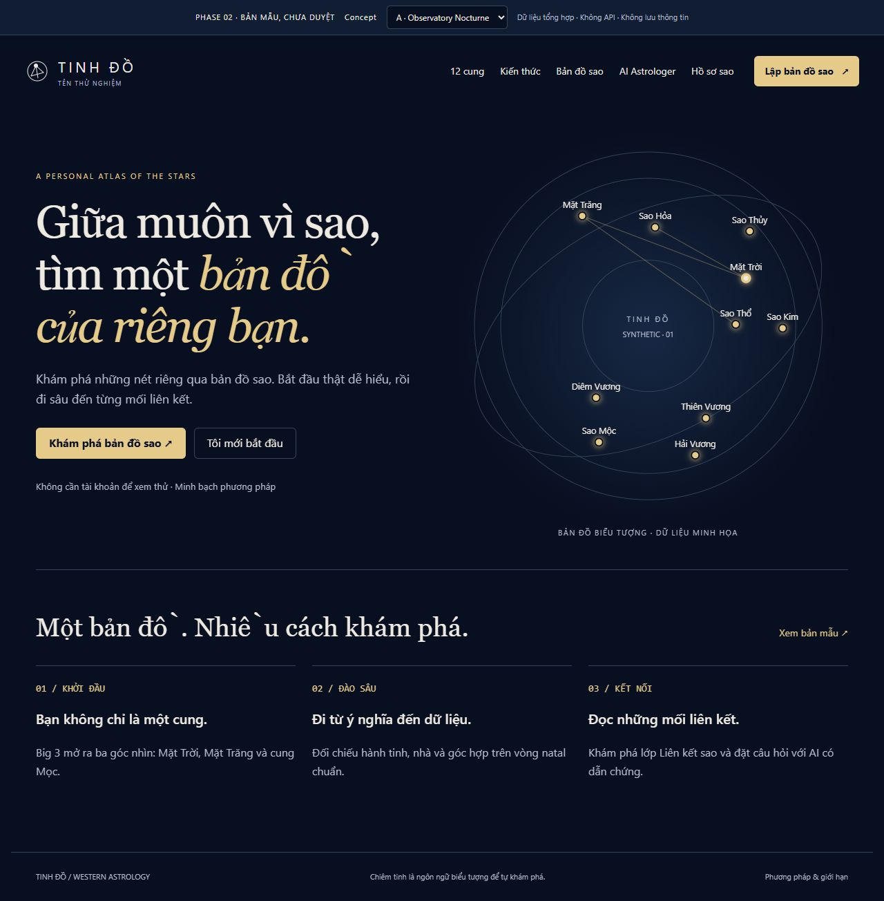
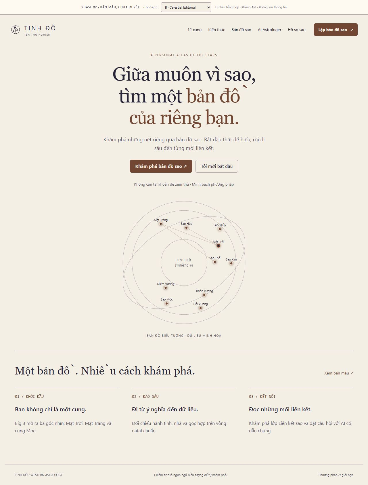
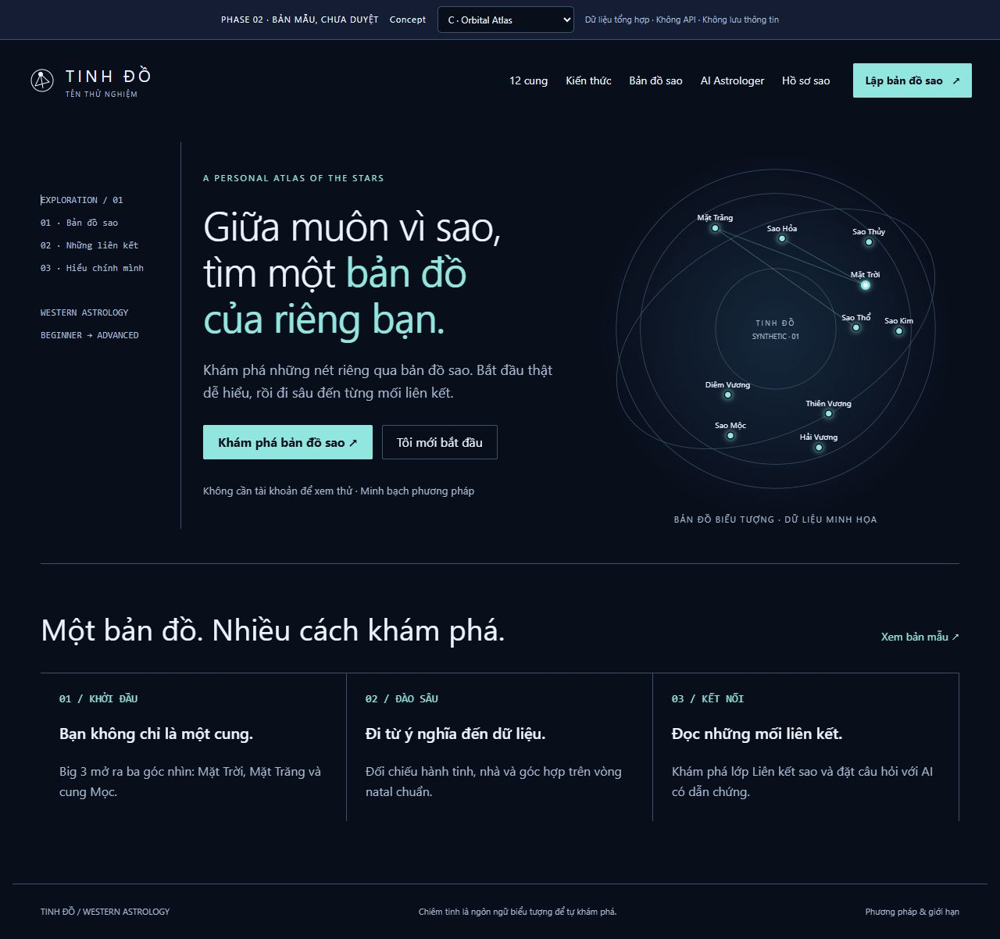

# Ba hướng thiết kế — chưa chốt concept
21/10/2026. Xem [prototype tương tác](prototype/index.html): chọn A/B/C ở thanh review, sau đó đổi trang để so sánh cùng chức năng. Mỗi concept có landing, form, chart, AI, dashboard và nội dung. Các hình chụp Western mới sẽ được lưu ở thư mục screenshots; ảnh a/b/c không có tiền tố western là lịch sử Tử Vi, không phải concept hiện tại.

| | A — Observatory Nocturne | B — Celestial Editorial | C — Orbital Atlas |
| --- | --- | --- | --- |
| Cảm giác | Đài quan sát đêm, tĩnh và quý | Tạp chí tri thức, thân thiện và sáng | Bàn khám phá dữ liệu, hiện đại |
| Bố cục landing | Hai vùng bất đối xứng: lời mời + vòng sao lớn | Headline giữa, biểu đồ như một bản khắc, dải bài đọc | Sidebar chỉ mục, bầu trời trải ngang, các chỉ số rõ |
| Chữ | Serif lớn + sans cho dữ liệu | Serif biên tập, cột đọc ngắn, số chương | Sans và monospace cho tọa độ |
| Màu | Navy mực, ngà và vàng nhạt | Giấy ấm, mực tím, terracotta | Xanh đen, cyan và violet tiết chế |
| Điểm mạnh | Hợp premium/mysterious, gắn Fate | Dễ đọc dài, người mới ít ngợp | Dữ liệu/chế độ chuyên sâu rõ |
| Đánh đổi | Cần kiểm tra độ tương phản và không quá tối | Cosmic ít kịch tính hơn | Có thể giống tool và làm người mới ngợp |
| Hiệu suất | SVG, không shader/particle loop | CSS + SVG, nền phẳng | SVG + panel, không WebGL |

## Bản mẫu trực quan để so sánh

A — Observatory Nocturne:

B — Celestial Editorial:

C — Orbital Atlas:

| Concept | Chart chuẩn | Liên kết sao | Mobile — Liên kết sao |
| --- | --- | --- | --- |
| A | [Xem](screenshots/western-a-chart-desktop.jpg) | [Xem](screenshots/western-a-constellation-desktop.jpg) | [Xem](screenshots/western-a-chart-mobile.jpg) |
| B | [Xem](screenshots/western-b-chart-desktop.jpg) | [Xem](screenshots/western-b-constellation-desktop.jpg) | [Xem](screenshots/western-b-chart-mobile.jpg) |
| C | [Xem](screenshots/western-c-chart-desktop.jpg) | [Xem](screenshots/western-c-constellation-desktop.jpg) | [Xem](screenshots/western-c-chart-mobile.jpg) |

27 ảnh Western: 21 màn desktop (7 màn × 3 concept), 3 Constellation desktop, 3 Constellation mobile. Các màn form/AI/dashboard/zodiac/learn có cùng tiền tố western-a/b/c trong thư mục screenshots. Thử trực tiếp bằng selector trong prototype để so sánh trạng thái/tương tác.

## Khuyến nghị sau khi so sánh
Chọn A để đáp ứng hướng cosmic premium; nội dung dài vẫn dùng cỡ chữ/khoảng dòng dễ đọc, không nhồi mọi trang thành màn game. Đây là ý kiến thiết kế, chưa có A/B test hoặc xác nhận của chủ dự án. B/C vẫn là lựa chọn khả thi, không mặc định “Cosmic Minimal Luxury” là phong cách cuối.

Homepage nên có một CTA chính “Khám phá bản đồ sao”, CTA phụ kiến thức, ba tầng giá trị và phương pháp. Không hiển thị số người dùng/review giả. Dashboard ưu tiên hồ sơ và thao tác thực tế. AI ưu tiên câu hỏi/dẫn chứng, không trang trí lấn nội dung. Chart có cùng vị trí điều khiển ở cả ba concept để so sánh chức năng.

## Cơ sở và phương pháp nghiên cứu
Nguồn thực tế: [đối thủ](../research/competitor-analysis.md). Dataset UI UX Pro Max được chạy lại cho “astrology editorial constellation web”; kết quả chung thiên Minimalism/Swiss phù hợp hierarchy/hiệu suất, không đủ đặc thù constellation nên không áp màu hồng/phông tự động làm quyết định. Lần tìm kiếm chart trước trả kết quả chưa phù hợp được lưu làm bằng chứng, không coi là recommendation đã kiểm chứng. Tuân theo [WCAG 2.2](https://www.w3.org/TR/WCAG22/): focus, contrast, touch và dữ liệu thay thế; chưa chứng nhận tuân thủ toàn diện.

## Phạm vi prototype
Tên Tinh Đồ, số đo, vị trí hành tinh và nội dung AI đều là giả định/demo. Input form chỉ thử UX, không tính chart thật. Chuyển concept không thay dữ liệu. SVG tự tạo, không lấy asset game. Xem [design system](design-system.md), [constellation](constellation-experience.md) và [brand](../product/brand-direction.md).
